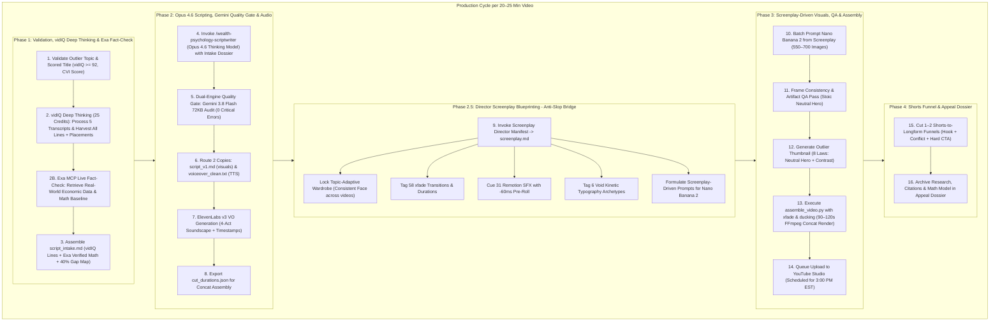

# 🚀 Master Production Pipeline: Quiet Money POV (Daily 1 Video / Day SOP)

> **Channel Brand:** **Quiet Money POV** (`@quietmoneypov`)  
> **Channel Concept:** Second-Person POV Wealth Psychology, Stealth Wealth, Life-Path Comparisons  
> **Target Audience:** Tier-1 English (US, UK, CA, AU) | Ages 18–35 | High-CPM Finance ($20–$45+ RPM)  
> **Production Cadence:** **Daily High-Impact Videos (1 Video / Day — 7 Videos / Week)** (Daily Releases at 3:00 PM EST)  
> **Target Runtime:** **20–25 Minutes** (**3,800–4,700 words @ 180–195 WPM** — optimal 4-act tension architecture & multi-mid-roll RPM)  
> **Visual Cadence:** **Two-Tier Dynamic Pacing** (~550–700 images: 0.8s–1.2s hyper-cuts in 30–45s hook; 1.8s–2.5s narrative body)  
> **Audio Architecture:** 4-Act Dynamic Soundscape + ElevenLabs v3 emotional tags  
> **Production Cost:** $0 beyond existing subscriptions (Antigravity IDE, ElevenLabs v3, Nano Banana 2, FFmpeg)  
> **Brand & Format Positioning:** The recurring protagonist is an illustrated stickman asset generated via Nano Banana 2, but the channel positioning is strictly second-person POV wealth psychology. The visual format is stickman; the brand is human financial reality.

---

## 🧭 The Daily Production Loop (24-Hour Turnkey Episode Sprint)

Production operates on a disciplined **Daily Cadence (1 Video Every Day released at 3:00 PM EST)**. The automated pipeline (Claude Opus Scripting + Gemini Flash Quality Gate + Screenplay Director Manifest + Nano Banana 2 batch visuals + ElevenLabs TTS + sub-2-minute FFmpeg concat) enables a complete 20–25 minute episode to be scripted, directed, rendered, and scheduled every 24 hours.

---

## ⚡ Why 1 Video Per Day at 20–25 Minutes Maximizes Algorithmic Growth & Watch Time

1. **Massive CPM & Mid-Roll Ad Revenue:**
   - 20–25 minute runtime unlocks 4 to 6 mid-roll placements. With Tier-1 English demographics in personal finance, RPM surges to **$20–$45+** (compared to $8–$15 on 8-minute videos).
2. **Two-Tier Dynamic Retention Engineering:**
   - **First 30–45 Seconds:** Hyper-cuts (0.8s–1.2s per image) trap immediate mobile browse attention, eliminating the initial 40% viewer drop-off.
   - **Body Narrative:** Settles into an engaging 1.8s–2.5s cadence with tension refreshes every 5–6 minutes across 4 acts.
3. **Turnkey Render Velocity:**
   - Even with 550–700 still images and master 44.1kHz audio, FFmpeg's concat demuxer compiles the entire 1080p master video in **under 2 minutes** on a standard local CPU.
4. **Algorithmic Velocity & Compound Exposure:**
   - Releasing 1 high-retention video per day creates massive algorithmic momentum. By pairing proven format skeletons with unique financial myths and emotional registers (the Hybrid PNC engine), every video targets a distinct psychological itch without cannibalizing your library or feeling like spam.

---

## 🛡️ YouTube Policy & Monetization Defense (2025–2027 Rules)

1. **Inauthentic Content Policy Defense:**
   - Faceless channels face algorithmic suppression if output resembles repetitive template clones.
   - *Defense:* Rotate across the 6 research-validated title formulas and 60 Hybrid combinations, vary the social dynamics of the POV scenarios, keep the Nano Banana 2 protagonist visually coherent across scenes, and ground every video in verifiable economic mechanics.
2. **Mandatory AI Disclosure Checkbox:**
   - Check *"Altered or Synthetic Content"* on every upload without exception.
3. **The "Appeal Dossier" Protocol:**
   - Archive raw `script_v1.md`, source spreadsheet calculations with cited return rates, prompt logs, and `assemble_video.py` execution manifests in each project folder: `projects/[NN]_[topic]/dossier/`.
4. **Feb 1, 2027 Monetization Threshold Doubling Defense:**
   - Requirements double on **February 1, 2027** from **4,000 watch hours to 8,000 watch hours**.
   - **Velocity Math (Daily Uploads):**
     $$\text{Weekly Watch Hours} = 7\text{ videos/week} \times 22.5\text{ min avg} \times 1,000\text{ avg views} = 2,625\text{ watch hours/week}$$
     *(At a conservative 50% Average View Duration: $7 \times 11.25\text{ min} \times 1,000 = 1,312.5\text{ watch hours/week}$.)*
   - At 2,625 hours/week, the current 4,000-hour threshold is crossed in **1.5 weeks** (11 videos); the doubled 8,000-hour threshold is cleared in **3.0 weeks** (22 videos). Daily production guarantees monetization clearance in record time.
5. **Subscriber Acquisition Math (The Binding Constraint):**
   - At POV Finance's verified monthly growth rate (+57.8%/month at 24.7K subs), trajectory metrics show:
     - **Week 1–4:** 0–200 subscribers (most initial videos receive <500 views while algorithm categorizes channel).
     - **Week 5–8:** A single breakout video spikes channel to 500–1,000 subscribers.
     - **Week 9–15:** If daily cadence holds and one video crosses 50K views, the 1,000-subscriber threshold is unlocked.
   - **Operational Takeaway:** Because our videos are 20–25 minutes long, watch hours will accumulate rapidly (2,625 WH/week). **Subscribers are the binding constraint.** High-converting thumbnails (8 Forensic Laws) and compelling 45s hyper-hooks are critical to convert casual browse impressions into subscribers.
6. **Revenue Projections by Tier-1 Finance RPM ($15–$35 RPM):**
   - Personal finance long-form (20–25 min) with 4–6 mid-rolls unlocks peak Tier-1 RPM:
     - **1,000 views/day:** $15 – $35 / day $\rightarrow$ **$450 – $1,050 / month**
     - **10,000 views/day:** $150 – $350 / day $\rightarrow$ **$4,500 – $10,500 / month**
     - **50,000 views/day (Dark Ledger territory):** $750 – $1,750 / day $\rightarrow$ **$22,500 – $52,500 / month**

---

## 📂 Modular SOP Directory Map

| SOP File | Scope & Function | Key Deliverables |
|---|---|---|
| [`01_RESEARCH_AND_VALIDATION_SOP.md`](01_RESEARCH_AND_VALIDATION_SOP.md) | Topic selection & outlier extraction across POV wealth psychology | Scored Title ($\ge 92$), Tier S Outlier dossier, Overlap/Gap Map, Keyword priority matrix |
| [`02_SCRIPTING_AND_STORY_SOP.md`](02_SCRIPTING_AND_STORY_SOP.md) | High-retention 4-act POV wealth storytelling (20–25 min) | 3,800–4,700 word narration, 4-act tension resets, 7–8% real-rate math verification |
| [`03_AUDIO_AND_VOICEOVER_SOP.md`](03_AUDIO_AND_VOICEOVER_SOP.md) | ElevenLabs v3 TTS synthesis & 4-act dynamic sound design | Master WAV voiceover, accurate `cut_durations.json`, 4-act music beds & SFX |
| [`screenplay_director_manifest-part-of-4-or-screenplay-writing-.md`](screenplay_director_manifest-part-of-4-or-screenplay-writing-.md) | Director & Video Editor Blueprinting (Anti-Slop Bridge) | Topic-adaptive wardrobe (consistent face), scene-by-scene `screenplay.md`, 58 `xfade` transitions, 31 Remotion SFX (-60ms pre-roll), 6 Void typography archetypes |
| [`04_VISUAL_ASSET_GENERATION_SOP.md`](04_VISUAL_ASSET_GENERATION_SOP.md) | Batch Nano Banana 2 visual scene creation (Screenplay-Driven Pacing) | 550–700 numbered PNGs (`img_001.png` to `img_700.png`), Visual QA consistency pass |
| [`05_FFMPEG_MASS_PRODUCTION_ASSEMBLY_SOP.md`](05_FFMPEG_MASS_PRODUCTION_ASSEMBLY_SOP.md) | Automated 1-click video compiler engine with transitions & ducking | Concat & xfade demuxer script, sub-2-minute 1080p MP4 render across 700 images |
| [`06_THUMBNAIL_WORKFLOW_SOP.md`](06_THUMBNAIL_WORKFLOW_SOP.md) | 8 forensic thumbnail laws reverse-engineering | Scored thumbnail ($\ge 92$), Neutral stickman hero, emotional supporting cast, diegetic UI numbers |
| [`07_PUBLISHING_SEO_AND_SHORTS_SOP.md`](07_PUBLISHING_SEO_AND_SHORTS_SOP.md) | Daily publishing metadata, chapters & Shorts funnel | YouTube Studio queue (Daily 3:00 PM EST), Shorts-to-longform conversion clips |
| [`finance_channel_brief.md`](finance_channel_brief.md) | Active channel setup & strategic positioning | Daily topic roadmap, brand assets, Tier S tracking |

---

## 🎯 Production & Operational Discipline

- **Rule 1: Production Before Consumption.** Focus exclusively on executing the active episode sprint. No browsing analytics, social feeds, or unrelated research.
- **Rule 2: Complete the Daily Cadence.** Maintain the Daily upload schedule (1 video every day at 3:00 PM EST). Do not begin drafting the next script until the current video is compiled, visually audited, and scheduled in YouTube Studio.
- **Rule 3: Enforce the 4-Act Tension Resets.** In every 20–25 minute script, introduce a new invisible social, institutional, or psychological cost every 5–6 minutes. Never allow a smooth, problem-free progression.
- **Rule 4: Zero Inflated Numbers.** Pin all compound growth to 7–8% real inflation-adjusted S&P 500 returns. Cite source models in the project `/dossier` folder.
