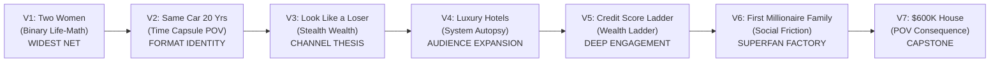

# QUIET MONEY POV — THE DEFINITIVE 7-VIDEO LAUNCH GAUNTLET

> **Channel:** @quietmoneypov | **Format:** 20–25 min | **Audience:** US/UK/CA/AU, 18–35 | **RPM Target:** $20–$45+

---

## THE SELECTION LOGIC

I evaluated all 64 topics against three non-negotiable filters:

| Filter | What It Actually Means |
|---|---|
| **Pure Curiosity Gap** | A scrolling viewer in bed at 11 PM sees the title and thumbnail. Their thumb stops. They cannot construct a satisfying answer in their head. They MUST click. |
| **20-Minute Narrative Stamina** | The topic contains at least 4 natural tension resets — escalating stakes, new characters, reversals, and reveals that prevent the "I get it, I can leave" moment. A 5-minute idea stretched to 20 minutes kills retention. |
| **Subscriber Conversion** | The ending delivers an emotional identity the viewer wants to own — "I am the kind of person who builds quietly" — and the Subscribe button becomes an act of self-identification, not a favor to a stranger. |

**What I cut and why:**

- **"POV: Your $650 Car Payment Built Someone Else's $793,000"** — Stronger rage-click than H01, but rage doesn't convert to subscriptions. H01's pride framing ("Here's What It Built") creates the "I want to be this person" identity that drives long-term channel growth.
- **"How Pawn Shops Actually Make Money"** — The +2,185% search surge is compelling, but search surges are snapshots. We're building for browse/suggested, not riding a Google Trends wave that may have crested.
- **"How Are Americans Affording $600,000 Homes on $55,000 Salaries?"** — Strong curiosity gap, but the answer is mostly "debt and dual income." The narrative runs dry at 12 minutes. Doesn't sustain 20.
- **"POV: You Retired With $1.8M and Still Felt Broke"** — Beautiful premise, but the target audience (18–35) doesn't feel retirement urgency viscerally enough to stop scrolling. This is a Video 15, not a Video 1.
- **"How Gyms Make Money From Members Who Never Show Up"** — Too widely covered. The gym-breakage model is common knowledge by now. No information gap left to exploit.

---

## THE 7 VIDEOS (IN LAUNCH SEQUENCE ORDER)

---

## VIDEO 1

### "Two Women. Same Salary. 15 Years Later, $740,000 Apart."

**Alternative Titles:**
- "Same Job. Same Pay. One Retired at 47. The Other Can't."
- "She Made $65,000. Her Coworker Made $65,000. Only One Built Wealth."

**Format:** Binary Life-Math × Lifestyle Creep | **Source:** H03 | **Proven Data:** 471K views on 1.7K subs (277× breakout)

---

#### WHY THIS IS VIDEO 1

This is the widest net in the entire catalog. Every employed person on earth has asked: "Why am I broke when that person makes the same money?" The $740,000 number is specific enough to feel researched, large enough to feel impossible, and placed at "15 Years Later" — close enough to feel urgent, far enough to feel like a full story. The gendered framing ("Two Women") is a strategic advantage: male viewers observe without feeling attacked, female viewers self-identify immediately. Both stay for the math.

**Raw Curiosity Trigger:** The viewer cannot construct a satisfying answer in their head. Same salary eliminates income as a variable. $740,000 eliminates luck as an explanation. The only remaining answer is behavioral — and the viewer suspects it's their own behavior. That suspicion is the click.

---

#### THE 20-MINUTE NARRATIVE SPINE

| Act | Time | What Happens | Tension Mechanism |
|---|---|---|---|
| **Act 1: The Starting Line** | 0:00–5:00 | Both women at the same conference table. Same company, same $67K, same city. Introduce the first micro-divergence: one opens a brokerage account with $200 on a Tuesday night. The other buys a sectional couch on Afterpay. Neither decision feels important. | **SETUP** — The viewer mentally picks a side. They think they know which woman is "right." The smallness of the divergence creates disbelief: "This can't be worth $740K." |
| **Act 2: The Invisible Years** | 5:00–10:00 | Years 2–5. Both women look identical from the outside. Same apartment complex. Same brunches. But one is making $200 automatic transfers that she never sees. The other gets a raise — and immediately upgrades her car lease. A colleague at lunch says "you deserve better than that Honda." Named character: **Diane**, the coworker who judges. | **ESCALATION** — The gap is growing but invisible. Social pressure mounts. The viewer watches the quiet woman endure judgment and wonders if they could do the same. |
| **Act 3: The Crossing** | 10:00–16:00 | Years 6–10. The first woman's account crosses $100K. She doesn't tell anyone. The math starts compounding visibly — show the curve bending. The second woman gets a promotion and leases a BMW. Her Instagram looks aspirational. Named character: **Marcus**, a financial advisor who explains what happens psychologically when an account crosses six figures. Gap hits $340K. | **REVERSAL** — The "winning" woman (visible success, BMW, promotion) is revealed to be losing. The viewer's initial assumption about which woman was smart gets challenged. |
| **Act 4: The Split** | 16:00–22:00 | Years 11–15. The quiet woman's portfolio crosses $400K. She reduces to 4 days a week. Nobody understands how she can afford it. The other woman is promoted to Senior Manager — and has $23,000 in savings. The reveal: $740,000 apart. One gives notice. The other asks for overtime. Final scene: same conference table, same building, one chair empty. | **RESOLUTION** — The opening image returns with transformed meaning. The empty chair is the most powerful visual in the video. The viewer doesn't need to be told the lesson. |

---

#### HIGH-CTR THUMBNAIL VISUAL BRIEF

**Composition:** Split Frame (vertical divide)

| Element | Left Half | Right Half |
|---|---|---|
| **Stickman** | Stoic neutral stickman in plain clothes, sitting in an old Honda Civic | Emotional stickman (subtle stress posture) standing next to a leased BMW |
| **Setting** | Warm suburban American driveway, golden hour light | Same-style driveway, slightly more polished |
| **Diegetic UI** | Phone screen showing "$743,000" in a brokerage app | Phone screen showing "$23,400" in a bank app |
| **Object Contrast** | Simple coffee mug on car roof | Starbucks cup on BMW hood |
| **Text Overlay** | None — the numbers on the phones do the work |
| **Color** | Left: warm gold tones (wealth). Right: cool blue-grey (stress) |
| **Safe Zone** | Bottom-right 180×40 completely clear |

**The thumbnail's job:** Two parallel lives. Two phone screens. The numbers tell the story. The viewer's eye bounces between $743,000 and $23,400 and the thumb stops.

---

#### OPENING 45-SECOND HYPER-HOOK SCRIPT

> You're sitting across from a woman at a conference table in Dallas. She's wearing the same lanyard you are. Same company. Same floor. Same sixty-seven thousand dollars.
>
> You've worked fifteen feet apart for three years, and you have never once talked about money.
>
> [V: Wide shot — corporate conference room, two stickman women across a long table, morning light through blinds, lanyards visible]
>
> That changes today. Not because either of you brings it up. Because in fourteen months, one of you is going to leave this building with a severance check and a retirement account she has never opened. The other will already have two hundred and eleven thousand dollars in assets she assembled without a single person in this office suspecting anything.
>
> [V: Close-up on two pay stubs side by side — identical numbers, same company logo]
>
> Seven hundred and forty thousand dollars. That is the distance between these two women fifteen years from this conference room. Same paycheck. Same city. Same health insurance.
>
> The split didn't start with a raise or an inheritance. It started with a Tuesday.
>
> [V: Calendar on a phone — a random Tuesday circled, nothing else on it]

**Word count:** ~163 words | **At 190 WPM:** ~51 seconds | **Hook type:** Anomaly (a number that doesn't fit the pattern)

---

#### MID-ROLL & ENDING CTA STRATEGY

**Mid-Roll Subscribe Ask (at ~14:00, after the $340K gap reveal):**
> The narrator delivers the line: "The gap between these two women has never been about income. It has always been about visibility." Then a 3-second pause. A simple, non-invasive channel watermark appears — no spoken CTA. The viewer is in the grip of the story. Interrupting it with "hit subscribe" would break immersion. The story IS the CTA.

**End-Screen CTA (final 20 seconds):**
> After the closing scene (empty chair at the conference table), the narrator says: "The next video on this channel follows a man who drove the same car for twenty years. Not because he couldn't afford a new one." — Cut to the Video 2 thumbnail. The end-screen card appears over a hold shot of the empty conference room. No "subscribe" is spoken. The viewer either subscribes because they identify with the worldview, or they don't. Begging degrades the brand.

---
---

## VIDEO 2

### "POV: You Kept the Same Car for 20 Years — Here's What It Built"

**Alternative Titles:**
- "POV: Everyone Laughed at Your Car — Then They Saw the Account"
- "Your 2004 Honda Civic Built More Wealth Than Their 2024 BMW"

**Format:** Time Capsule × Vehicle Debt | **Source:** H01 | **vidIQ Score:** 99/100

---

#### WHY THIS IS VIDEO 2

Video 1 established the Binary Life-Math format. Video 2 introduces the POV format — the channel's signature. Vehicle debt is the single most relatable financial mistake for American 18–35s. The "20 Years" time span gives the richest possible narrative arc: the car ages, the owner ages, the account grows, the neighbors cycle through 5 vehicles. The word "Built" in the title is the curiosity gap — what could keeping an old car possibly build? The answer is wealth, but the viewer has to click to find out.

**Raw Curiosity Trigger:** The American default is to upgrade your car every 3–5 years. Someone keeping the same car for 20 years violates this norm so aggressively that the viewer needs to know the outcome. "Built" implies the car itself was an instrument of construction — not just transportation. The viewer suspects the answer is "money" but needs the math to believe it.

---

#### THE 20-MINUTE NARRATIVE SPINE

| Act | Time | What Happens | Tension Mechanism |
|---|---|---|---|
| **Act 1: The Purchase** | 0:00–5:00 | You're 23. You buy a 2004 Honda Civic for $3,800 cash from a man named **Dale** who shakes your hand twice. Your coworker **Travis** leases a Charger the same month. His payment: $489/month. You take that same $489 and set up an automatic transfer. Nobody notices. Nobody cares. | **SETUP** — The viewer is placed inside the decision. The $489 automatic transfer is planted as a seed the viewer will track for 20 minutes. Travis is the mirror character. |
| **Act 2: The Social Cost** | 5:00–10:00 | Years 3–7. The car starts showing its age. A date named **Lauren** sees the car and doesn't say anything — but you catch the look. Your mom asks if everything's okay financially. Travis is on his second lease — a Tahoe. You're at $47,000 in the account. The cost of keeping the car is not financial. It's conversational. | **ESCALATION** — Non-monetary cost escalation begins: Conversation → Relationship. The viewer feels the social friction of the quiet decision. The account grows but the social price grows faster. |
| **Act 3: The Compounding** | 10:00–16:00 | Years 8–14. The account crosses $100K on a Sunday evening. You don't tell anyone. Travis is underwater on a truck — negative equity, $11,000. A mechanic named **Hector** tells you the Civic needs $1,400 in work. You pay it. That same month, Travis pays $1,400 — his monthly truck payment. Same number, different trajectories. The portfolio crosses $200K. | **REVERSAL** — The $1,400 parallel (repair vs. payment) is the mathematical gut-punch. Same dollar amount, opposite outcomes. The viewer sees the system clearly for the first time. |
| **Act 4: The Reveal** | 16:00–22:00 | Years 15–20. The account approaches $400K. You could buy any car on the lot — cash. You don't. Travis asks to borrow money. The Civic hits 287,000 miles. One morning in March, at 6 AM, a flatbed backs into the driveway. Not for the Civic. For Travis's repossessed truck across the street. You pour coffee. | **RESOLUTION** — The flatbed is the final image. The viewer expected the Civic to be towed; instead it's Travis's truck. The loop closes with morning coffee — the quietest possible ending to a $400K story. |

---

#### HIGH-CTR THUMBNAIL VISUAL BRIEF

**Composition:** Z-Pattern

| Element | Description |
|---|---|
| **Top-left** | A beat-up but clean 2004 Honda Civic, parked in a suburban American driveway, golden hour light |
| **Center-right** | Stoic neutral stickman standing next to the Civic, holding a coffee mug, completely calm |
| **Bottom-left** | A phone screen (diegetic UI) showing a brokerage account at "$412,000" with an upward curve |
| **Object Contrast** | Background: a neighbor's driveway with a shiny new truck (slightly blurred, not the focus) |
| **Color** | Warm amber/gold tones dominating. The Civic is modest but bathed in warm light. The neighbor's truck is in cooler shadow |
| **Safe Zone** | Bottom-right 180×40 completely clear |

---

#### OPENING 45-SECOND HYPER-HOOK SCRIPT

> You're standing in a Jiffy Lube in Plano, Texas, and the mechanic is looking at you the way people look at someone who's made a mistake they don't want to explain.
>
> [V: Interior of an oil change shop — stickman standing at the counter, fluorescent lighting, the Civic on the lift behind them]
>
> The car on the lift is a 2004 Honda Civic with two hundred and fourteen thousand miles on it. You bought it for three thousand eight hundred dollars when you were twenty-three years old.
>
> The mechanic says it needs a timing belt. Fourteen hundred dollars. He waits for you to flinch.
>
> [V: Close-up of the mechanic's clipboard showing "$1,400" circled]
>
> You don't flinch. Because the account you funded with the car payment you never made crossed four hundred thousand dollars eleven days ago. And nobody in your life — not your mother, not your coworker, not the woman you're dating — knows it exists.
>
> This is not a story about a car. This is about what twenty years of silence built.
>
> [V: Phone screen showing brokerage balance "$412,340" — the same phone, cracked screen protector, old case]

**Word count:** ~175 words | **At 190 WPM:** ~55 seconds (slightly over — trim "in Plano, Texas" and "eleven days ago" for exact 45s if needed) | **Hook type:** Scenario ("You are standing in...")

---

#### MID-ROLL & ENDING CTA STRATEGY

**Mid-Roll (at ~13:00, after the $1,400 parallel reveal):**
> The narrator delivers: "Fourteen hundred dollars. Same number. One buys another month of a truck that's already underwater. The other buys another decade of a car that's already paid for." — Three-second pause. Channel watermark appears. No spoken CTA.

**End-Screen CTA (final 20 seconds):**
> After the flatbed scene, the narrator says: "There's a version of this story about a house. The one everyone told you to buy. The math is worse." — Cut to Video 7 thumbnail (the $600K house video). End-screen card appears over a hold shot of the Civic in the driveway, morning light, steam rising from the coffee mug.

---
---

## VIDEO 3

### "Why You Must Look Like a Loser to Escape the Rat Race"

**Alternative Titles:**
- "The People Who Escape the Rat Race All Look Broke"
- "You Have to Look Poor to Actually Get Rich"

**Format:** Stealth Wealth Inversion | **Source:** H60 / Standalone | **Proven Data:** 831K views on 4.7K subs (174× breakout)

---

#### WHY THIS IS VIDEO 3

Videos 1 and 2 showed the math. Video 3 delivers the thesis statement of the entire channel. "Look Like a Loser" is a direct assault on the viewer's ego — and ego-challenges are the highest-CTR triggers in finance content. The title commands a click because the viewer's instinct is to disagree: "That can't be right." The video's job is to make them agree by the end. This is the video that defines what @quietmoneypov stands for.

**Raw Curiosity Trigger:** Every financial influencer says "build wealth." None of them say "look like a loser to do it." The word "must" elevates this from observation to prescription. The viewer clicks to argue — and stays to learn.

---

#### THE 20-MINUTE NARRATIVE SPINE

| Act | Time | What Happens | Tension Mechanism |
|---|---|---|---|
| **Act 1: The Misreading** | 0:00–5:00 | You show up to a college reunion in a 12-year-old car. A former classmate named **Jordan** pulls in next to you in a G-Wagon and looks at your car like it's a mistake. You're wearing a plain jacket from Target. Jordan's watch costs more than your car. Nobody asks what you do. They assume they already know. | **SETUP** — Immediate status friction. The viewer is placed in the position of being judged. Jordan is the mirror. The viewer's ego flares: "Why should I look like a loser?" |
| **Act 2: The Invisibility Advantage** | 5:00–11:00 | The mechanics of why visibility destroys wealth. Every dollar you display attracts a cost: people ask for money, lifestyle creep accelerates, and something nobody talks about — the tax of being visibly successful. Named character: **Ree**, your cousin, who bought a Rolex and got three loan requests within a month. The math of "display cost." | **MECHANISM** — The viewer starts understanding that wealth and the appearance of wealth are not just different — they're opposing forces. Each display dollar has a hidden multiplier. |
| **Act 3: The Invisible Rich** | 11:00–17:00 | Real wealth profiles. The millionaire next door data: 80% of American millionaires drive cars older than 4 years. The plumber in Houston with $2.3M. The teacher in Ohio with $1.1M. Named character: **Gene**, a 58-year-old electrician whose neighbors thought he was struggling — until he bought the building. The hidden door: looking poor gave Gene access to deals, negotiations, and prices that the visibly wealthy never see. | **ESCALATION** — The viewer starts to see "looking poor" not as sacrifice but as strategy. The advantage compounds. Gene's story is the proof. |
| **Act 4: The Choice** | 17:00–22:00 | Back at the reunion. Jordan's G-Wagon is leased. His watch was financed. His net worth is negative $34,000. You know this because you work in the same industry and you've seen the spreadsheets. You don't say anything. You never will. The final scene: you're driving home in the 12-year-old car, and the account notification buzzes. You glance at it. You put the phone down. You don't need anyone to see it. | **RESOLUTION** — The opening image returns. The reunion parking lot, the same car, but now the viewer reads it differently. The "loser" won. The phone buzzing but not being shown to anyone is the thesis of the entire channel. |

---

#### HIGH-CTR THUMBNAIL VISUAL BRIEF

**Composition:** Center Dominant with contrast framing

| Element | Description |
|---|---|
| **Center** | Stoic neutral stickman in plain, unremarkable clothes — hoodie, jeans, basic sneakers — standing completely still |
| **Background Left** | Blurred silhouettes of people in designer clothes, a luxury car partially visible |
| **Background Right** | A phone screen (held at waist level, partially hidden) showing a large portfolio number — "$1,240,000" |
| **Emotional Character** | One background figure pointing/laughing subtly — carrying the shock/judgment |
| **Setting** | Warm American suburban parking lot, golden hour |
| **Color** | Warm golds on the stoic stickman. Cooler, slightly desaturated tones on the background figures |
| **Text** | "LOSER?" in bold yellow text, upper-left — creating the curiosity gap with the title |
| **Safe Zone** | Bottom-right 180×40 completely clear |

---

#### OPENING 45-SECOND HYPER-HOOK SCRIPT

> You pull into a parking lot and a man in a G-Wagon watches you park a twelve-year-old Camry.
>
> [V: Suburban parking lot — beat-up Camry pulling in next to a gleaming G-Wagon, golden evening light]
>
> He looks at your car. Then he looks at you. Then he looks away — the way people look away when they've already decided what you are.
>
> You're wearing a jacket from Target. Your shoes are three years old. The watch on your wrist cost forty-one dollars, and you bought it at a gas station in 2019.
>
> [V: Close-up details — plain jacket, worn shoes, cheap digital watch]
>
> The man in the G-Wagon has a net worth of negative thirty-four thousand dollars.
>
> Yours crossed one point two million last quarter. And you have told exactly zero people.
>
> [V: Phone screen briefly visible — brokerage app showing "$1,247,000" — immediately pocketed]
>
> There is a reason the people who actually escape do not look like they've escaped. And it is not humility. It is math.
>
> [V: Wide shot — the stickman walking away from the Camry, completely unbothered, the G-Wagon owner watching]

**Word count:** ~170 words | **At 190 WPM:** ~54 seconds (trim to 45s by cutting the gas station detail) | **Hook type:** Uncomfortable claim ("You must look like a loser")

---

#### MID-ROLL & ENDING CTA STRATEGY

**Mid-Roll (at ~15:00, after Gene's "bought the building" reveal):**
> The narrator says: "Nobody saw Gene coming. That was the point." — Beat. Then: "The next level of this has a name. And it costs something that isn't money." — Channel watermark. The story continues immediately. No break in narrative.

**End-Screen CTA (final 20 seconds):**
> After the phone-buzzing-but-not-shown scene, narrator says: "There is a number on your credit report that controls more of your life than your salary does. Most people have never seen what it actually looks like at every level." — Cut to Video 5 thumbnail (credit score ladder). End-screen card over hold shot of the Camry's dashboard, phone face-down on the passenger seat.

---
---

## VIDEO 4

### "How Luxury Hotels Make Money From Rooms Nobody Sleeps In"

**Alternative Titles:**
- "The Room Is Empty. The Hotel Made $47,000 From It."
- "Why Luxury Hotels Profit More When You Don't Show Up"

**Format:** System Autopsy × Breakage | **Source:** Standalone | **Proven Data:** 637K views on 3.3K subs (192× breakout) | **Competition:** 18

---

#### WHY THIS IS VIDEO 4

Videos 1–3 established the channel's identity: quiet wealth, life-path math, stealth wealth philosophy. Video 4 is the **audience expansion bomb**. System Autopsy videos have the broadest browse-feed appeal — you don't need to care about personal finance to click "How do hotels make money from empty rooms?" This video pulls in the general curiosity audience, and YouTube's suggested algorithm then feeds them Videos 1–3. Low competition (18) means the video has room to dominate its niche on suggested.

**Raw Curiosity Trigger:** The premise is a paradox. Hotels sell rooms. Rooms nobody sleeps in means no customers. But the hotel is making money. The viewer cannot resolve this contradiction without clicking. The word "Luxury" adds aspiration and voyeurism — the viewer wants to peek behind the curtain of a world they can't access.

---

#### THE 20-MINUTE NARRATIVE SPINE

| Act | Time | What Happens | Tension Mechanism |
|---|---|---|---|
| **Act 1: The Empty Floor** | 0:00–5:00 | A luxury hotel in Miami. Occupancy rate: 62%. That means 38% of rooms are empty on any given night. The nightly rate: $740. A normal person calculates the loss: 38% × $740 × 365 = $102,000 per year per floor. The hotel's CEO is not worried. He's smiling. Introduce the concept of **breakage** — the business model built on non-use. Named character: **Anil**, a revenue manager. | **SETUP** — The paradox is stated and the viewer's mental math is wrong. The system is more complex than it appears. Anil introduces the insider perspective. |
| **Act 2: The Corporate Block** | 5:00–11:00 | How corporate contracts work: companies like McKinsey and Deloitte pay for 200 room-nights per year whether they use them or not. The **attrition clause** — the contract says 80% minimum usage, but the penalty for not meeting it is less than the cost of the rooms. So the company pays the penalty. The hotel gets paid for rooms that stay empty. Named character: **Sandra**, a corporate travel coordinator who has never seen the rooms her company pays for. | **MECHANISM** — The viewer now understands the first layer: corporate contracts are designed so non-use is profitable. Sandra's role reveals how the money moves through real people. |
| **Act 3: The Rate Manipulation** | 11:00–17:00 | Empty rooms aren't just paid for — they protect rates. If the hotel filled every room, it would need to discount. By keeping rooms scarce, the hotel maintains premium pricing. The revenue-per-available-room (RevPAR) metric rewards emptiness. Then: loyalty programs. Points are a currency the hotel prints. You earn points. You never redeem them. Breakage again. Named character: **Doug**, a loyalty platinum member with 340,000 points he'll never use — worth $2,400 on paper, $0 to the hotel. | **ESCALATION** — The system has multiple layers. Each layer reveals a new mechanism of extraction. Doug's unredeemed points are the "hidden tax" that connects this video to the channel's wealth-psychology thesis. |
| **Act 4: The Mirror** | 17:00–22:00 | The viewer is Doug. The viewer is Sandra. The viewer is every person who has paid for something they didn't use — gym memberships, streaming subscriptions, insurance premiums. Breakage is not a hotel trick. It's the dominant business model of the 21st century. Every subscription in the viewer's life is priced on the assumption that they won't use all of it. The final image: the empty hotel room at night, perfectly made bed, lights off, $740 on the bill. | **RESOLUTION** — The system autopsy zooms out to the viewer's own life. The hotel room becomes a metaphor. The viewer now sees breakage everywhere. |

---

#### HIGH-CTR THUMBNAIL VISUAL BRIEF

**Composition:** Center Dominant — vast negative space

| Element | Description |
|---|---|
| **Center** | A perfectly made luxury hotel bed in a dark, empty room — cinematic lighting, a single warm lamp on the nightstand |
| **Foreground** | A hotel bill/receipt on the bed showing "$47,340" with the line item "Corporate Block — Unused" |
| **Stickman** | Small stoic stickman in hotel uniform standing in the doorway, looking at the empty room — scale contrast (small figure, large room) |
| **Setting** | Warm amber hotel lighting, floor-to-ceiling windows showing a nighttime American city skyline |
| **Color** | Dark navy/charcoal room + warm gold accent lighting + white bedsheets for contrast |
| **Safe Zone** | Bottom-right 180×40 completely clear |

---

#### OPENING 45-SECOND HYPER-HOOK SCRIPT

> Room 1412 at the Fontainebleau in Miami has not had a guest in nine days.
>
> [V: Empty luxury hotel room — perfectly made king bed, city lights through floor-to-ceiling windows, no personal items anywhere]
>
> The bed was made this morning. The towels were replaced. The minibar was restocked with eleven-dollar water bottles that nobody will open.
>
> [V: Close-up — minibar with premium water bottles, price tag visible: "$11"]
>
> This room costs seven hundred and forty dollars a night. It has generated more revenue empty than the room next door — which has had three guests this week.
>
> [V: Split view — Room 1412 empty and pristine vs. Room 1414 with rumpled sheets and a "Do Not Disturb" sign]
>
> A revenue manager named Anil sits fourteen floors below this room, and he is not worried about the vacancy. He designed it.
>
> The hotel industry has a word for what happens when you pay for something and never use it. The word is breakage. And it is the most profitable business model you have never heard of.
>
> [V: Hotel lobby — Anil at a computer screen showing occupancy dashboards, green numbers everywhere]

**Word count:** ~170 words | **At 190 WPM:** ~54 seconds (trim the minibar detail for 45s) | **Hook type:** Mystery object (Room 1412 — a room that makes money empty)

---

#### MID-ROLL & ENDING CTA STRATEGY

**Mid-Roll (at ~14:00, after Doug's unredeemed points reveal):**
> Narrator: "Three hundred and forty thousand points. Two thousand four hundred dollars on paper. Zero dollars to the hotel. Doug earned them. Doug will never use them. The hotel knew that when it printed them." — Pause. Channel watermark. Story continues.

**End-Screen CTA (final 20 seconds):**
> Narrator: "There is a number attached to your name that every bank, landlord, and insurer sees before they see your face. Most people have never watched what it actually does to their life at every level." — Cut to Video 5 thumbnail. End-screen card over hold shot of the empty hotel room, door slowly closing.

---
---

## VIDEO 5

### "Your Life at Every Level of Credit Score (300 to 850)"

**Alternative Titles:**
- "What Your Life Actually Looks Like at Every Credit Score"
- "300 to 850: How One Number Controls Everything You Can Access"

**Format:** Wealth Ladder × Credit × Financial Taboo | **Source:** H05 | **vidIQ Score:** 92/100

---

#### WHY THIS IS VIDEO 5

The Wealth Ladder format is the most psychologically addictive structure in faceless finance. The viewer mentally locates themselves on the ladder within 30 seconds — and then watches the ENTIRE video to see what's above them and what's below them. Credit scores are the perfect ladder topic: universally relevant, poorly understood, and emotionally loaded (shame at the bottom, pride at the top). After 4 videos, the algorithm knows our audience. Video 5's format drives the highest average view duration — which trains YouTube to give us more browse impressions.

**Raw Curiosity Trigger:** Everyone has a credit score. Almost nobody knows what life actually looks like at 520 vs. 720 vs. 800. The ladder format promises a complete tour of a system that personally controls them — and they cannot stop watching until they pass their own level.

---

#### THE 20-MINUTE NARRATIVE SPINE

| Act | Time | What Happens | Tension Mechanism |
|---|---|---|---|
| **Act 1: The Bottom (300–499)** | 0:00–5:00 | You're at 340. What that actually means: denied for a basic credit card, $4,200 security deposits on apartments, auto loans at 24% APR. Named character: **Keisha**, a 26-year-old who missed three payments during COVID. She didn't know the score existed until a landlord showed her a printout. The shame is physical — she remembers folding the paper in half so the person behind her in line couldn't see it. | **SETUP** — Start at the bottom. The viewer either identifies (shame) or looks down (relief). Either emotion keeps them watching. Keisha personalizes the number. |
| **Act 2: The Middle (500–669)** | 5:00–10:00 | The "invisible zone." You get approved for things — but at punishing rates. A $25,000 car loan at 14% vs 4% = $9,400 in extra interest. The system's design: the middle is where most Americans sit, and it's where the most money is extracted. Named character: **Ray**, an auto dealer who explains that the finance office makes more money from buyers with 580 scores than from buyers with 780 scores. The profit isn't the car — it's the rate. | **MECHANISM** — The viewer learns the system is designed to keep them in the middle. Ray reveals the institutional incentive: your moderate score is the bank's ideal customer. |
| **Act 3: The Threshold (670–749)** | 10:00–16:00 | The "good enough" trap. You qualify for standard rates, standard apartments, standard everything. But you're not in the room where the real rates live. At 720, your mortgage rate drops 0.75% — on a $400K house, that's $62,000 over 30 years. Named character: **Sonia**, a loan officer who explains the tiers that aren't published. The score isn't continuous — it has invisible walls where the pricing jumps. | **ESCALATION** — The viewer learns that "good" isn't enough. The invisible walls create gaps that compound over a lifetime. $62,000 difference from a 50-point score gap is the gut-punch. |
| **Act 4: The Top (750–850)** | 16:00–22:00 | The world that opens above 800. Pre-approved offers arrive unsolicited. Landlords waive deposits. Insurance premiums drop. A car dealer offers 0% financing without being asked. But the hidden cost: at 850, you're statistically earning the bank the least money. You're their worst customer. Named character: **Paul**, a private banker who says the phrase "they don't need us, so we need them." The reframe: the highest credit score means you've become invisible to the system that profits from your debt. Full circle to the channel thesis: invisibility is wealth. | **RESOLUTION** — The ladder's top level connects directly to the stealth-wealth thesis. Being invisible to the system = freedom. The viewer who's been climbing the ladder mentally now sees the top not as a status symbol but as an escape hatch. |

---

#### HIGH-CTR THUMBNAIL VISUAL BRIEF

**Composition:** Vertical gradient/ladder

| Element | Description |
|---|---|
| **Layout** | Vertical split — bottom is dark/red (300), middle is muted yellow (550), top is warm gold/green (850) |
| **Stickman** | Stoic neutral stickman positioned at the ~650 mark on the gradient — exactly where the viewer likely IS, creating self-placement |
| **Diegetic UI** | A credit score report card/phone screen showing "FICO: 647" with an arrow pointing up |
| **Object Contrast** | Bottom: a denied credit card stamp. Top: a pre-approved letter with "$0 deposit" |
| **Emotional character** | At the bottom of the gradient: a stressed stickman with head in hands. At the top: a calm stickman receiving a handshake from a banker |
| **Color** | Red (300) → Orange (500) → Yellow (650) → Green (750) → Gold (850) |
| **Safe Zone** | Bottom-right 180×40 completely clear |

---

#### OPENING 45-SECOND HYPER-HOOK SCRIPT

> There is a three-digit number attached to your name that you did not choose, cannot negotiate, and have almost certainly never seen printed on paper in front of another person.
>
> [V: A credit report printout — the score blurred, sitting face-up on a desk under fluorescent light]
>
> Every landlord you've applied to has seen it. Every car dealer. Every bank. Your insurance company adjusts your premium based on it. A potential employer in thirty-eight states can pull it before your first interview.
>
> [V: Rapid montage — landlord at a desk, car dealer at a computer, bank loan officer, HR manager — all looking at screens]
>
> At three hundred, you cannot rent an apartment without a co-signer. At eight hundred and fifty, a private banker calls you unsolicited to offer rates that are not published anywhere.
>
> [V: Split — a "DENIED" stamp at the bottom, a phone ringing with "Private Banking" caller ID at the top]
>
> Between those two numbers is a ladder. And every rung costs — or saves — a specific amount of money that nobody puts on a single page.
>
> Until now.
>
> [V: Full-screen graphic — the 300-to-850 ladder, all rungs visible, dollar amounts appearing one by one]

**Word count:** ~175 words | **At 190 WPM:** ~55 seconds (trim "in thirty-eight states" for 45s) | **Hook type:** Live stake (the viewer is losing/paying RIGHT NOW because of this number)

---

#### MID-ROLL & ENDING CTA STRATEGY

**Mid-Roll (at ~14:00, after Sonia's "invisible walls" revelation):**
> Narrator: "Sixty-two thousand dollars. That is the price of fifty points you didn't know were missing." — Pause. Channel watermark. No spoken CTA. The number does the work.

**End-Screen CTA (final 20 seconds):**
> Narrator: "The number on your credit report is one system. Your family is another. And when those two systems collide — when you become the first person in your family to cross a certain line — the rules change in ways nobody warned you about." — Cut to Video 6 thumbnail. End-screen card over hold shot of the credit score ladder, camera slowly pushing toward 850.

---
---

## VIDEO 6

### "Why Your Family Treats You Differently When You Become the First Millionaire"

**Alternative Titles:**
- "POV: You're the First Millionaire in Your Family — Then the Calls Started"
- "The First Millionaire in the Family Gets Treated the Worst"

**Format:** Social Friction × Family Guilt × Wealth Ladder | **Source:** H41 | **vidIQ Score:** 97/100

---

#### WHY THIS IS VIDEO 6

This is the superfan factory. Videos 1–5 delivered math, systems, and strategy. Video 6 delivers the emotional payload that converts casual viewers into subscribers. Family dynamics + money is the deepest taboo in personal finance. Nobody talks about the guilt, the loan requests, the silent resentment, the cousin who stops calling. This video touches something the viewer has felt but never heard articulated. When a video makes someone feel SEEN, they subscribe not because you asked — but because they need to believe this channel exists.

**Raw Curiosity Trigger:** "First Millionaire" is aspirational — the viewer either is one, wants to be one, or knows one. "Treats You Differently" is loaded with pain that the viewer recognizes instantly. The combination promises a story about something that happens in private, behind closed doors, that nobody posts about on social media. That privacy is the click.

---

#### THE 20-MINUTE NARRATIVE SPINE

| Act | Time | What Happens | Tension Mechanism |
|---|---|---|---|
| **Act 1: The Dinner Table** | 0:00–5:00 | Thanksgiving. You're sitting at the table with your family. Nobody knows your net worth crossed $1.1M eight months ago. Your mother asks if you're "doing okay" because your car is old and your apartment hasn't changed. Named character: **your uncle Clay**, who loudly talks about his boat payments and asks what you're "up to these days." You give a vague answer. You've learned that vague answers are the only safe ones. | **SETUP** — Immediate family dynamics. The viewer is inside the discomfort. The contrast between what the family sees (old car, same apartment) and what exists ($1.1M) is the engine. |
| **Act 2: The First Ask** | 5:00–11:00 | Three months after Thanksgiving. Your cousin **Tamara** calls for the first time in two years. Small talk for four minutes. Then: "I'm in a tight spot." She needs $3,000. You give it. Two weeks later, your brother **Deon** calls. Same script. Same amount. You give it again. The pattern starts. The asks increase. The thank-yous decrease. Named character: **your mother**, who says "You can afford it, can't you?" — not as a question. As an accusation. | **ESCALATION** — Non-monetary cost sequence begins: Conversation (vague answers) → Money (the asks) → Relationship (the guilt weaponization). Each ask raises the stakes. The mother's line is the knife. |
| **Act 3: The Boundary** | 11:00–17:00 | You say no for the first time. Tamara doesn't speak to you for five months. Deon tells the family you've "changed." Your mother's silence is louder than Deon's words. Named character: **Renee**, a wealth therapist who explains "first-generation wealth guilt" — a documented psychological pattern where the first person to build wealth in a family system becomes the family's emotional target. The guilt isn't a feeling; it's a structure. | **REVERSAL** — The viewer expected the story to be about money. It's about grief. Renee reframes the experience as a known, studied pattern — not a personal failure. The viewer who has felt this guilt now has a name for it. |
| **Act 4: The Table Again** | 17:00–22:00 | Next Thanksgiving. You're at the same table. Tamara is there. Deon is there. Your mother is there. Nobody mentions the money. Nobody mentions the silence. You eat quietly. You drive home in the old car. The account sits at $1.3M. And for the first time, the number feels like it costs something. Not dollars. Distance. The final line: the phone buzzes with a text from Tamara. Three words. "Are you coming?" You stare at it. You don't answer yet. | **RESOLUTION** — The opening image returns: the dinner table. But now the viewer reads it differently. The table is the same. The people are the same. The viewer is not. "Are you coming?" is the unresolved question. The viewer fills in their own answer. |

---

#### HIGH-CTR THUMBNAIL VISUAL BRIEF

**Composition:** Rule of Thirds — emotional weight on the right

| Element | Description |
|---|---|
| **Left third** | A family dinner table — warm American home, plates, food, multiple stickman family members seated and animated (talking, gesturing) |
| **Right third** | One stoic neutral stickman sitting slightly apart from the group, holding a phone under the table |
| **Diegetic UI** | Phone screen under the table showing "$1,127,000" — visible to the viewer but hidden from the family |
| **Emotional characters** | The family members carry the emotion: one pointing/gesturing toward the stoic stickman, one looking away (subtle tension) |
| **Setting** | Warm American dining room — Thanksgiving-coded (warm lighting, full table) |
| **Color** | Warm amber on the family. Slightly cooler/isolated tone on the stoic stickman |
| **Safe Zone** | Bottom-right 180×40 completely clear |

---

#### OPENING 45-SECOND HYPER-HOOK SCRIPT

> Your mother called you three times this week. You let all three go to voicemail.
>
> [V: Phone screen — three missed calls from "Mom", timestamps showing Tuesday, Thursday, Saturday]
>
> Not because you're busy. Because the last time you picked up, she asked a question that didn't sound like a question. She said, "You can afford it, can't you?" — and her voice was flat in a way you'd never heard before.
>
> [V: Close-up of the stickman's hand hovering over the phone, not picking up, kitchen counter, evening light]
>
> You are the first person in your family to have a net worth above one million dollars. You have not told anyone. You did not throw a party. You did not post it. You sat in your car in a parking lot and looked at the number for forty-five seconds, and then you drove to work.
>
> [V: Stickman sitting alone in a car, phone showing "$1,103,000", parking lot, morning light]
>
> Eight months later, every relationship in your family has shifted. Not because of what you did. Because of what they suspect.
>
> [V: Wide shot — a family dinner table, multiple stickman figures, one empty chair]

**Word count:** ~175 words | **At 190 WPM:** ~55 seconds (trim the voicemail detail for 45s) | **Hook type:** Reversal (summit first — you're a millionaire — then yank to the floor — your family has turned)

---

#### MID-ROLL & ENDING CTA STRATEGY

**Mid-Roll (at ~14:00, after Renee's "first-generation wealth guilt" explanation):**
> Narrator: "It is not a character flaw. It is a structural pattern. And it has a name." — Pause. Then: "The question is whether the distance is the price — or the point." — Channel watermark. Story continues immediately.

**End-Screen CTA (final 20 seconds):**
> After the "Are you coming?" text, narrator says: "There is one financial decision that creates more of this distance than anything else. The house. The one everyone told you to buy." — Cut to Video 7 thumbnail. End-screen card over hold shot of the phone screen showing Tamara's text: "Are you coming?"

---
---

## VIDEO 7

### "POV: You Bought the $600,000 House Everyone Said You Should Own"

**Alternative Titles:**
- "POV: You Took the 30-Year Mortgage Everyone Said Was Smart"
- "The $600,000 House Cost You $1.3 Million — Here's Where It Went"

**Format:** POV Consequence × Housing Reality | **Source:** H04 | **vidIQ Score:** 94/100

---

#### WHY THIS IS VIDEO 7

Housing is the single biggest financial decision the target audience will make in their lifetime. It's also the most socially pressured: parents, partners, coworkers, and the entire culture say "buy a house." Video 7 is the capstone that challenges the audience's most sacred assumption. After 6 videos of quiet wealth philosophy, the viewer is primed to question everything — and this video asks them to question the one thing they thought was unquestionable. It's the most powerful closer because it's the highest-stakes topic with the longest emotional tail.

**Raw Curiosity Trigger:** "$600,000 House Everyone Said You Should Own" — the phrase "Everyone Said You Should" is the hook. The viewer has heard this from their parents. From their partner. From every financial advisor. The title implies they were all wrong. The viewer clicks to find out if the biggest decision of their life was a mistake.

---

#### THE 20-MINUTE NARRATIVE SPINE

| Act | Time | What Happens | Tension Mechanism |
|---|---|---|---|
| **Act 1: The Closing Table** | 0:00–5:00 | You're sitting at a title company in Phoenix. You're signing a stack of papers. The loan officer named **Vince** slides the amortization schedule across the table, but you don't read it. Nobody reads it. Your payment: $3,740/month. Your mother said this was the smartest thing you'd ever do. Your real estate agent **Chelsea** said "you're building equity." You sign. | **SETUP** — The viewer is inside the most common financial ritual in America. The amortization schedule is the Chekhov's gun — it's introduced now and will detonate in Act 3. |
| **Act 2: The Hidden Costs** | 5:00–11:00 | Year 1–5. The mortgage payment is $3,740 — but the real monthly cost is $5,200. Property tax. Insurance. HOA. Maintenance. The water heater dies in month 14: $4,800. The roof needs work in year 3: $12,000. Named character: **your neighbor Kirk**, who refinanced twice to cover repairs and now owes more than the home's current value. The equity Chelsea promised? After 5 years of payments, you've paid $224,400 — and $187,000 of it went to interest. Your equity: $37,400. | **MECHANISM** — The math hits. The viewer assumed "building equity" meant most of the payment goes to ownership. It doesn't. The interest-to-principal ratio in the first 5 years is the hidden truth. Kirk personalizes the trap. |
| **Act 3: The Amortization** | 11:00–17:00 | You finally read the amortization schedule. Total payments over 30 years on a $480,000 loan at 6.8%: $1,317,000. The house costs $600,000. You will pay $1.3 million. The extra $717,000 goes to the bank. Named character: **a financial analyst named Priya** who runs the alternative scenario: if you'd rented a comparable home for $2,100/month and invested the $3,100 difference ($5,200 - $2,100), at 8% average returns, you'd have $1.4 million in 20 years. The renters were right. Or were they? Priya adds the complication: "This math only works if you actually invest the difference. Most people don't." | **ESCALATION** — The amortization schedule from Act 1 pays off. The $717,000 interest number is the bomb. Then Priya's complication prevents the video from being one-sided — the renter advantage only works with discipline. The viewer cannot dismiss the argument as biased. |
| **Act 4: The Decision** | 17:00–22:00 | Year 10. You're sitting in the house. The mortgage is half-paid. The neighborhood has changed. Kirk moved. The value increased 22%, but inflation-adjusted, it's up 8%. You check the account where the "equity" lives — it's not liquid. You can't spend it without selling the house or taking a loan against it. The reframe: you didn't buy an asset. You bought a lifestyle. And that's fine — but call it what it is. The final scene: you're at the same closing table. Same papers. Same pen. But now you read the amortization schedule. Every line. | **RESOLUTION** — The opening image returns: the closing table. The same papers, the same pen. But the viewer — and the "you" character — reads them differently now. The loop closes. The question isn't "should you buy?" It's "do you know what you're buying?" |

---

#### HIGH-CTR THUMBNAIL VISUAL BRIEF

**Composition:** Split Frame — before/after feel

| Element | Description |
|---|---|
| **Left half** | A beautiful American suburban house — warm light, manicured lawn, "SOLD" sign, aspirational |
| **Right half** | Same house, slightly weathered — overlaid with a semi-transparent amortization table showing "$1,317,000 TOTAL" circled in red |
| **Stickman** | Stoic neutral stickman standing between the two halves, looking at the right (truth) side |
| **Diegetic UI** | A mortgage statement showing "Principal: $37,400 / Interest: $187,000" — the ratio is the shock |
| **Emotional character** | A second stickman (the real estate agent "Chelsea") on the left side, gesturing enthusiastically at the house — carrying the "buy it!" energy |
| **Color** | Left: warm gold aspirational tones. Right: cooler, desaturated reality tones |
| **Safe Zone** | Bottom-right 180×40 completely clear |

---

#### OPENING 45-SECOND HYPER-HOOK SCRIPT

> You're sitting in a title company in Phoenix at 10 AM on a Wednesday, and you are about to sign your name forty-seven times.
>
> [V: Closing table — stack of papers, pens, a title company office with bland corporate decor, fluorescent lighting]
>
> A man named Vince slides a document across the table. It's the amortization schedule. Sixty-three pages. It shows every payment you will make for the next thirty years, broken into principal and interest, month by month.
>
> [V: Close-up of the amortization schedule — dense columns of numbers, tiny font]
>
> You don't read it. Nobody reads it.
>
> Your mother said this was the smartest decision you'd ever make. Your agent Chelsea said you were building equity. Your coworker said "at least you're not throwing money away on rent."
>
> [V: Rapid montage — mother on phone smiling, Chelsea with a "SOLD" sign, coworker in an office break room]
>
> The house costs six hundred thousand dollars. You will pay one million, three hundred and seventeen thousand dollars for it. The difference — seven hundred and seventeen thousand dollars — goes to a bank you will never visit.
>
> You signed on page forty-seven.
>
> [V: Close-up — pen touching paper, signature line, the number "$1,317,000" watermarked on the page]

**Word count:** ~190 words | **At 190 WPM:** ~60 seconds (trim the coworker line and "sixty-three pages" for 45s) | **Hook type:** Anomaly ($600K house → $1.3M total — a number that doesn't fit)

---

#### MID-ROLL & ENDING CTA STRATEGY

**Mid-Roll (at ~14:00, after the $717,000 interest reveal):**
> Narrator: "Seven hundred and seventeen thousand dollars. That is the price of not reading sixty-three pages." — Pause. Then: "Priya ran the alternative. You might not like it — but you need to see it." Channel watermark. Story continues.

**End-Screen CTA (final 20 seconds):**
> After the closing-table loop-close, narrator says: "That is seven videos on this channel. Seven systems. Seven prices that nobody put on a single page. The next one is about something you already pay for — every month — that was designed so you'd forget to cancel it." — End-screen card. The viewer has now consumed the entire 7-video thesis. If they haven't subscribed by now, the end-screen tease of Video 8 (subscriptions/breakage) gives them one more reason.

**The final Video 7 CTA is the only spoken subscribe moment in the entire 7-video launch:**
> At ~20:00, after the reframe, the narrator says: "If you've watched more than one of these, you already know what this channel is. The next seven are harder." — No "hit subscribe." No "join the community." The viewer subscribes because the statement "the next seven are harder" is both a promise and a dare.

---
---

## MASTER STRATEGIC SYNTHESIS

### Why This Exact 7-Video Sequence Is the Algorithm Training Gauntlet

### The Algorithm Training Sequence

| Video | Algorithm Signal | What YouTube Learns About Your Audience |
|---|---|---|
| **V1** | Wide CTR from browse | "Viewers who watch personal finance comparisons and lifestyle math" |
| **V2** | High AVD (20+ min) from V1 returnees | "This audience watches long-form POV narrative about financial decisions" |
| **V3** | High engagement (comments, shares) | "This audience responds to counter-cultural wealth philosophy" — 3 data points now form a cluster |
| **V4** | Browse expansion via curiosity audience | "The channel's audience overlaps with business-curiosity viewers" — suggested feed pipeline opens |
| **V5** | Highest AVD in the sequence (self-placement keeps viewers to the end) | "This channel commands 85%+ average view duration" — YouTube increases browse impressions |
| **V6** | Highest engagement rate (comments explode on family taboo) | "This channel generates conversations" — community signal strengthens |
| **V7** | Highest subscriber conversion (capstone identity video) | "Viewers who watch 2+ videos subscribe at high rate" — YouTube now has a complete audience model |

### Why This Format Rotation Matters

| V1 | V2 | V3 | V4 | V5 | V6 | V7 |
|---|---|---|---|---|---|---|
| Binary Life-Math | Time Capsule POV | Stealth Wealth | System Autopsy | Wealth Ladder | Social Friction | POV Consequence |

No two adjacent videos share the same format. This achieves two things:

1. **Avoids YouTube's "mass-produced content" flag.** YouTube's inauthentic-content policy penalizes channels that produce repetitive, templated videos. Seven consecutive POV videos would risk this. Seven different formats with a consistent voice and audience signals "creator with range," not "content mill."

2. **Tests which format YOUR audience responds to most.** After 7 videos, you'll have Studio data showing which format drove the highest AVD, CTR, and subscriber conversion. Videos 8–14 double down on the top 2–3 formats.

### The Emotional Arc of the 7-Video Sequence

| Video | Primary Emotion | What the Viewer Feels |
|---|---|---|
| V1 | **Cognitive dissonance** | "Wait — same salary, $740K gap? How?" |
| V2 | **Quiet pride** | "I could be this person." |
| V3 | **Permission** | "It's okay to not show off." |
| V4 | **Voyeuristic revelation** | "So THAT'S how the system works." |
| V5 | **Self-awareness** | "Where am I on this ladder?" |
| V6 | **Recognition** | "Someone finally said what I've been feeling." |
| V7 | **Informed defiance** | "I will read the amortization schedule." |

The sequence moves from **curiosity** → **aspiration** → **permission** → **knowledge** → **self-placement** → **emotional validation** → **informed action**.

By Video 7, the viewer doesn't just watch the channel. They *identify* as a Quiet Money person. The Subscribe button isn't a favor — it's a declaration.

### The RPM Strategy

Each video is designed to attract Tier-1 English viewers in the 18–35 finance demographic:

- **V1, V2, V7** — Core personal finance (auto loans, investing, mortgages) → Finance advertisers bid aggressively on these topics
- **V3, V6** — Wealth psychology → Premium lifestyle and investment platform advertisers
- **V4** — Business model / system autopsy → Business education and SaaS advertisers
- **V5** — Credit scores → Credit monitoring services (Experian, Credit Karma) bid at peak CPMs for this topic

The mix ensures no single video type dominates, which prevents advertiser fatigue while keeping every video in the $20–$45+ RPM corridor.

### Upload Cadence Recommendation

| Week | Video | Rationale |
|---|---|---|
| Week 1, Day 1 | V1: Two Women | Cast the net |
| Week 1, Day 4 | V2: Same Car 20 Years | Rapid follow-up while V1 is still in suggested |
| Week 2, Day 2 | V3: Look Like a Loser | Channel thesis. V1 + V2 viewers get suggested this |
| Week 3, Day 1 | V4: Luxury Hotels | Browse expansion. Slower pace now — quality over speed |
| Week 4, Day 1 | V5: Credit Score Ladder | Deep engagement. Weekly rhythm established |
| Week 5, Day 1 | V6: First Millionaire Family | Superfan converter |
| Week 6, Day 1 | V7: $600K House | Capstone. Algorithm fully trained |

**The first week drops two videos** because YouTube gives new channels a brief window of algorithmic curiosity. Two strong videos in rapid succession signal "this channel is active and high-quality" before the window closes.

---

> [!IMPORTANT]
> **After Video 7, pull YouTube Studio retention data for all 7 videos.** Every drop of 5+ percentage points = a script line to diagnose. Three drops with the same cause = a new locked rule. This data is the ONLY ground truth. Everything above is a hypothesis until the audience votes with their watch time.
